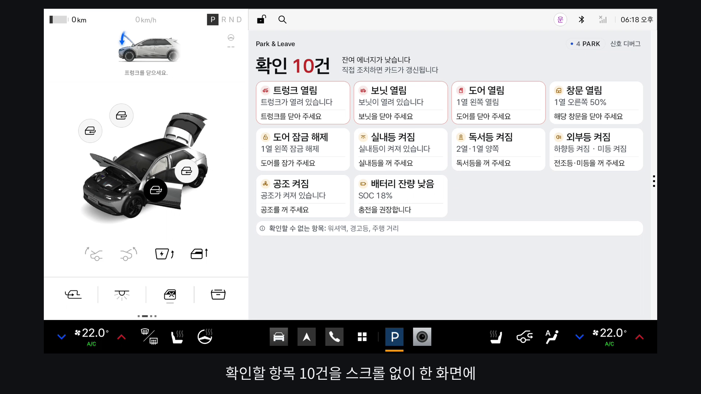
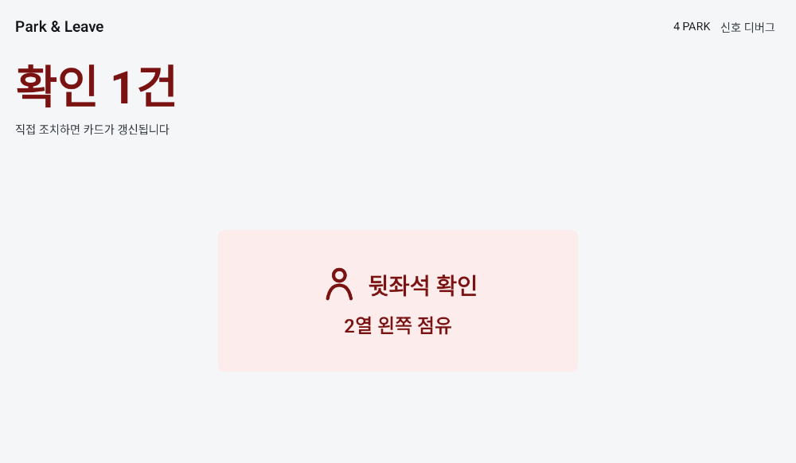
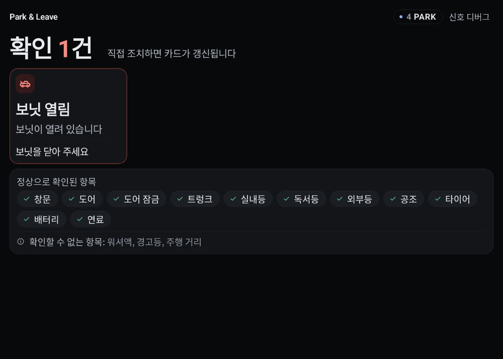
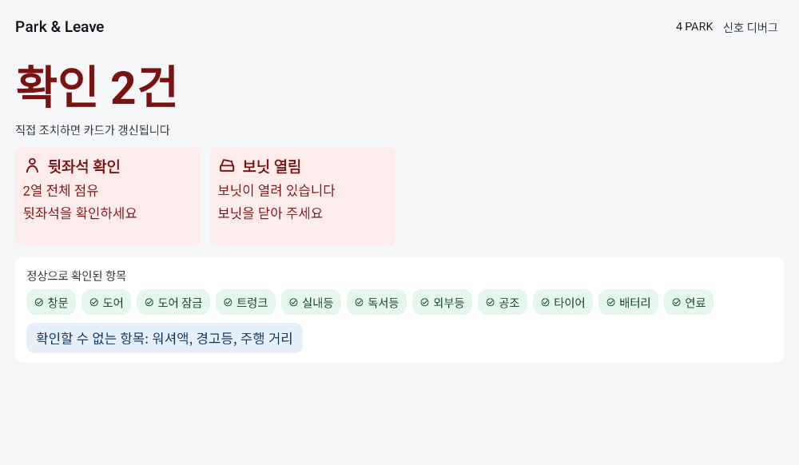
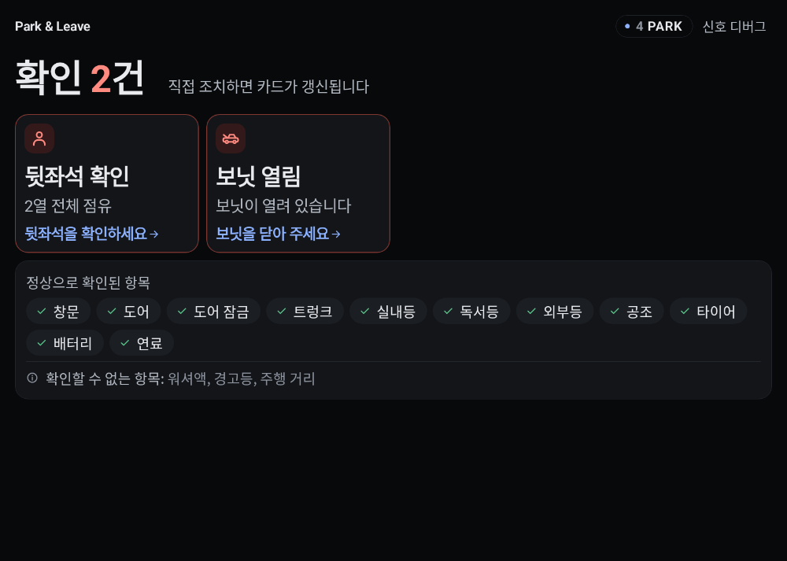
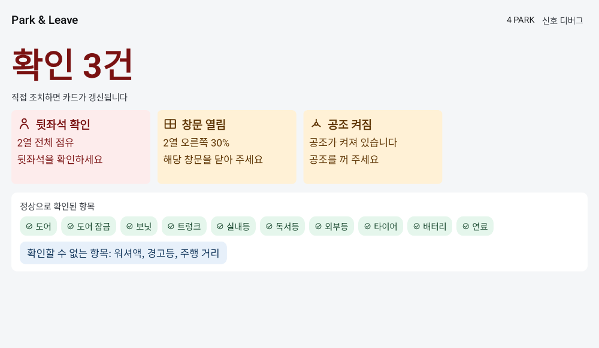
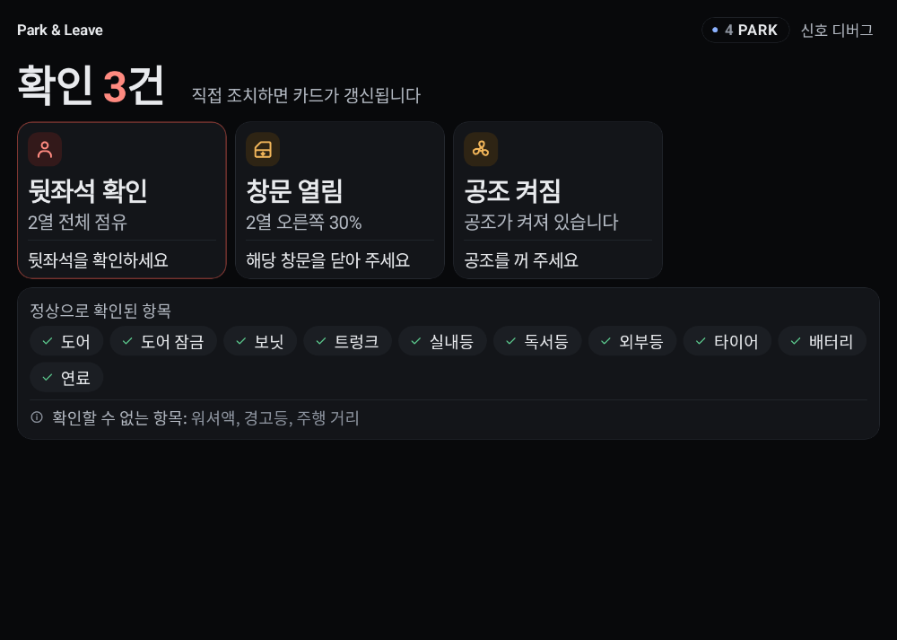
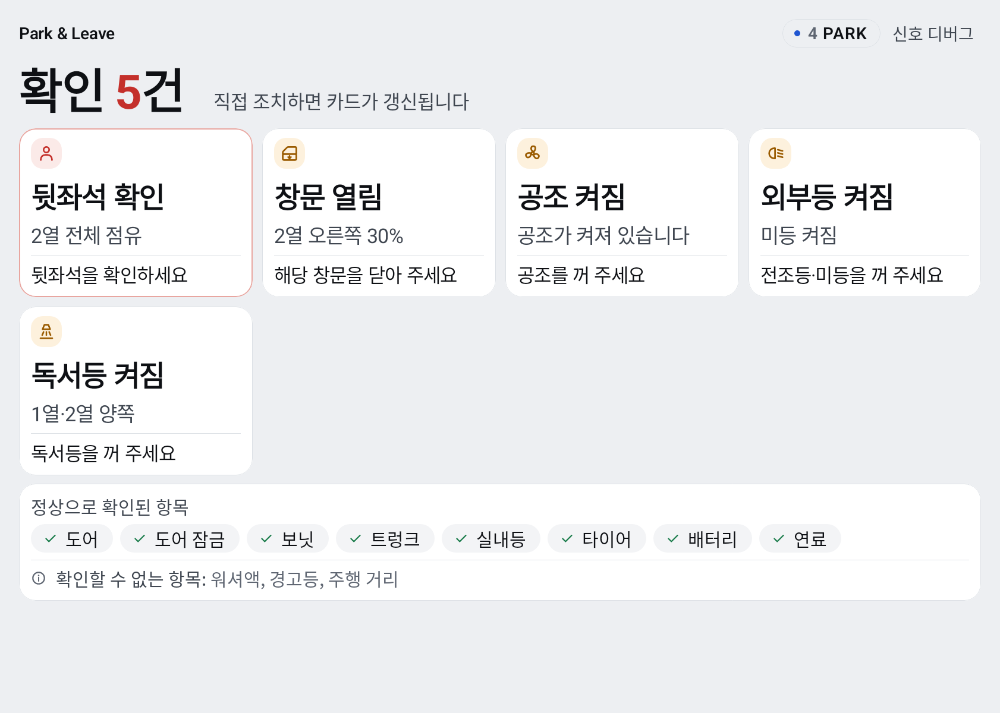
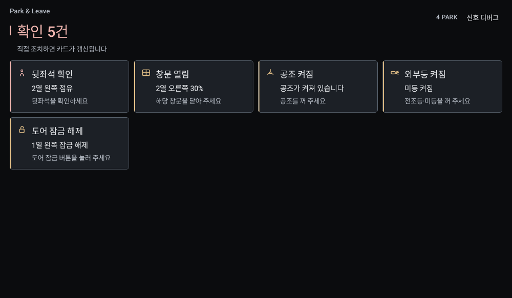

# Park & Leave

기어를 P로 두는 순간 창문, 도어 잠금, 보닛·트렁크, 실내등·외부등, 공조, 타이어, 워셔액, 배터리, 연료를 한 번 읽고, 내릴 때 볼 항목만 카드로 모읍니다. 읽을 수 있는 값이 모두 정상이면 "모두 정상 / 내려도 됩니다"를 보여주고, 앱이 확인하지 못한 신호는 "확인할 수 없는 항목: …" 한 줄로 남깁니다. SOC가 있으면 그 줄에서 연료는 뺍니다. 정차가 아니면 점검 화면을 열지 않습니다.

## 시연 영상

[](docs/demo/park-and-leave-demo.mp4)

[시연 영상(mp4, 60초)](docs/demo/park-and-leave-demo.mp4): Pleos Connect Emulator 2.1.0에서 가상 콘솔로 신호를 바꾸며 찍었습니다. D단 제한 화면, P단 카드 10장, 하나씩 해결해 "확인된 이상 없음"까지 이어집니다.

## 기능

- P에 들어가면 차량 상태를 한 번 읽고, P를 벗어났다가 다시 들어오면 다시 읽습니다.
- 확인 카드는 창문, 도어, 잠금, 보닛, 트렁크, 조명, 공조, 타이어, 워셔액, 배터리, 연료, 읽을 수 있는 경고등입니다. 보닛과 트렁크는 도어 잠금에 섞지 않고 "보닛 열림", "트렁크 열림"으로 둡니다.
- 이번 정차에서 해결된 항목은 "해결됨"으로 남고, 정차가 끝나면 지워집니다. 모든 신호를 읽고 전부 해결되면 "모두 정상" 아래 "해결된 항목"으로 남습니다. 읽지 못한 신호가 있으면 해결됨 카드 없이 "확인된 이상 없음"과 정상 항목만 보여 줍니다.
- 확인 카드는 장수와 상관없이 4열 한 칸과 같은 크기입니다. 왼쪽부터 채우고, 다섯 장째부터 다음 줄로 넘어갑니다. 한 줄의 카드는 높이가 같습니다. 본문은 최대 두 줄이고, 그 아래 조치 한 줄이 있습니다. 카드 아래에는 정상으로 확인된 항목을 내용 높이만큼 둡니다.
- 신호마다 실패를 따로 처리합니다. 한 항목의 `SecurityException`이나 미제공이 다른 항목을 지우지 않습니다.
- 값이 null이면 정상으로 세지 않고 "확인할 수 없음"으로 둡니다.
- 차량 서비스가 연결되지 않았거나 끊기면 카드를 정상으로 두지 않고 "차량 서비스: 연결되지 않음"을 보여 줍니다.
- 주간과 야간 색을 시스템 설정에 맞춥니다.

## 화면

에뮬레이터에서 앱이 차지하는 넓은 영역을 기준으로 한 화면입니다.

카드는 한 장이어도 네 장일 때와 같은 너비로 왼쪽에 붙습니다. 아래 영역은 정상으로 확인된 항목이고, 화면 아래까지 늘어나지 않습니다.









세 장과 다섯 장도 같은 카드 크기입니다. 다섯 장은 다음 줄로 넘어갑니다.









## 사용하는 API

기어는 Vehicle SDK `Gear` API를 쓰지 않습니다. SDK 2.3.2 `Gear` KDoc은 `getCurrentGearSelectionState`와 `registerGearSelection`을 deprecated로 두고, 플랫폼 `GEAR_SELECTION` 프로퍼티를 쓰라고 합니다. 이 앱은 AAOS `CarPropertyManager`로 `VehiclePropertyIds.GEAR_SELECTION`(`289408000`)을 읽습니다. P는 4, R은 2, N은 1, D는 8입니다.

나머지 조회는 `ai.pleos.playground:Vehicle:2.3.2`입니다. capability에서 읽기가 없으면 그 항목은 숨깁니다.

| 화면 항목 | 호출 |
|---|---|
| 기어 | `Car.createCar`, `CarPropertyManager.getIntProperty` / `registerCallback`, `VehiclePropertyIds.GEAR_SELECTION` |
| 주행 제한 | `CarUxRestrictionsManager` |
| 창문 | `Window.checkWindowPositionCapabilities`, `getCurrentWindowPosition`, `registerWindowPosition` |
| 도어 위치 | `Door.checkDoorPositionCapabilities`, `getCurrentDoorPosition`, `registerDoorPosition` |
| 도어 잠금 | `Door.checkDoorLockCapabilities`, `getDoorLockState`, `registerDoorLockState` |
| 실내등, 하향등, 미등, 독서등 | `Light.check*Capabilities`, `getCurrent*`, `register*` |
| 공조 | `HVAC.checkHvacPowerCapabilities`, `getHvacPowerState`, `registerHvacPowerState` |
| 타이어 저압 | `Tire.checkLowTirePressureCapabilities`, `getLowTirePressure` |
| 워셔액 | `Safety.checkLowWasherFluidWarningStateCapabilities`, `hasLowWasherFluidWarning`, `registerLowWasherFluidWaringState` |
| 경고등 | `Safety.getTelltalesInfo` 한 번 |
| 배터리 SOC | `EvBattery.checkEvBatteryStateOfChargeCapabilities`, `getEvBatteryStateOfCharge`, `registerEvBatteryStateOfCharge` |
| 연료 | `Fuel.checkFuelPercentCapabilities`, `getFuelPercent`, `registerFuelPercent` |
| 이번 트립 거리 | `Odometer.checkTripCurrentDrivingDistanceCapabilities`, `getTripCurrentDrivingDistance`, `registerTripCurrentDrivingDistance` |

선언한 권한은 `android.car.permission.CAR_POWERTRAIN`과 `pleos.car.permission.CAR_WINDOWS`, `CAR_DOORS`, `CAR_LIGHTS`, `CAR_SAFETY`, `CAR_ENERGY`, `CAR_DRIVE`, `CAR_CLIMATE`입니다. `PRIVATE_*`와 `CONTROL_*`는 선언하지 않습니다. 독서등과 공조는 좌석 영역으로 읽지만 `Seat` API를 쓰지 않으므로 `CAR_SEATS`는 선언하지 않습니다.

도어 잠금 Boolean은 SDK `setDoorLock` 설명대로 true가 잠김, false가 해제입니다. 도어 위치는 최소값 0이 닫힘이고 그보다 크면 열림입니다. 보닛과 트렁크는 위치가 열려 있거나 래치가 풀리면 각각의 열림 카드로 두고, 실내 도어 잠금 카드에는 넣지 않습니다. SOC 값이 있으면 연료는 확인할 수 없는 항목에서 뺍니다.

## 정차 중에만

주행 중 사용(distraction optimization)을 매니페스트에 선언하지 않습니다. AAOS는 그 선언이 없는 화면을 주행 중에 제한합니다. 앱도 기어가 P일 때만 점검 세션을 엽니다. D, R, N에서는 카드를 만들지 않습니다. `CarUxRestrictions`가 운전자 주의 분산 최소화를 요구하면 실측 세션을 멈춥니다. 화면에는 애니메이션을 넣지 않았습니다.

## 빌드와 실행

- JDK 17
- Android SDK Platform 35, Build-Tools 35
- `ANDROID_HOME` 또는 `local.properties`의 `sdk.dir`

```bash
./gradlew test assembleDebug assembleRelease
```

산출물:

- `app/build/outputs/apk/debug/app-debug.apk`
- `app/build/outputs/apk/release/app-release.apk`

release 서명은 `PARK_LEAVE_STORE_FILE`, `PARK_LEAVE_STORE_PASSWORD`, `PARK_LEAVE_KEY_ALIAS`, `PARK_LEAVE_KEY_PASSWORD`를 환경 변수나 `~/.gradle/gradle.properties`에서 읽습니다. 값이 없으면 디버그 키스토어로 서명하고 빌드는 계속됩니다. 키스토어 파일은 커밋하지 않습니다. 제출용 복사 위치는 `apk/README.md`에 있습니다.

앱 ID는 `io.github.kwn00.parkandleave`입니다. minSdk 28, targetSdk 34, compileSdk 35.

Pleos Connect Emulator를 Cold boot로 띄운 뒤:

```bash
adb install -r app/build/outputs/apk/debug/app-debug.apk
adb shell am start -n io.github.kwn00.parkandleave/.MainActivity
adb forward tcp:8088 tcp:8088
```

브라우저에서 `http://127.0.0.1:8088/` 을 열고 Gear, 도어, 잠금, 창문, 조명, 공조, 배터리, 연료, 타이어를 바꿉니다. Quick boot에서는 차량 신호가 오지 않을 수 있습니다. 데모 촬영 순서는 `docs/demo-scenario.md`에 있습니다.

요약 화면의 **신호 디버그**는 `GEAR_SELECTION` raw 값과 읽은 신호를 보여 줍니다. **모의**는 에뮬레이터 없이 카드를 볼 때 쓰는 가짜 데이터입니다. 모의 모드에는 주행 제한을 적용하지 않습니다.

## 한계

- 경고등은 서드파티 앱이 읽을 수 없습니다. Vehicle SDK 2.3.2 `Safety` KDoc은 `getTelltalesInfo`, `checkTelltalesCapabilities`, `registerTelltales`에 `pleos.car.permission.PRIVATE_CAR_SAFETY`(protection level `signature|privileged`)를 적습니다. `SafetyImpl`은 `@RequiresCustomPermission(PleosPermission.PRIVATE_CAR_SAFETY)`로 검사하고, 권한이 없으면 `PermissionUtil`이 `SecurityException`을 던집니다. 인터페이스의 `getTelltalesInfo`에는 `@RequiresPermission(CAR_SAFETY)`도 붙어 있습니다. `CAR_SAFETY`는 normal 권한이라 이 앱이 선언하지만, KDoc과 구현의 검사는 `PRIVATE_CAR_SAFETY`입니다. Android는 `signature|privileged`를 선언 인증서와 같은 앱, 또는 권한 허용 목록에 있는 시스템 앱에만 줍니다. 일반 앱은 받을 수 없습니다. 그래서 경고등 실패는 "확인된 이상 없음"으로 세지 않습니다. 읽을 수 있는 신호가 정상이면 "모두 정상 / 내려도 됩니다"와 함께 "경고등: 이 차량에서 앱이 읽을 수 없음"을 보여 줍니다. 참고: [permission element](https://developer.android.com/guide/topics/manifest/permission-element#plevel).
- 타이어 압력 구독 `registerTirePressure`도 같은 private 권한이라 저압은 조회만 합니다. `getLowTirePressure`가 null이면 정상 압력이 아니라 "확인할 수 없음"입니다. 0은 저압 아님, 0 초과 1 이하는 저압, 더 큰 값은 단위가 문서에 없어 카드로 올리지 않습니다.
- 창문, 조명, 잠금을 앱이 대신 끄거나 잠그지는 않습니다. 직접 조치하면 구독 값이 카드를 갱신합니다.
- 음성은 짧은 알림음만 냅니다. 모두 정상이면 소리가 없습니다.
- 트립 거리 float의 단위는 SDK 시그니처만으로 확정하지 않아 숫자 그대로 둡니다. SOC 20% 미만, 연료 15% 미만을 확인 항목으로 보고, SOC 30% 미만이면서 이번 트립 거리가 0보다 크면 "내일 같은 거리라면 충전 권장"을 덧붙입니다.
- `getDoorLockState`의 Boolean은 잠김=`true`로 해석합니다.

## 모듈

- `domain`: 점검 규칙, P 재진입과 연결 상태의 순수 리듀서, 모의 시나리오. JVM 단위 테스트.
- `designsystem`: 주간과 야간 색, 글자 크기.
- `app`: Compose 화면, AAOS 기어, Vehicle SDK.
